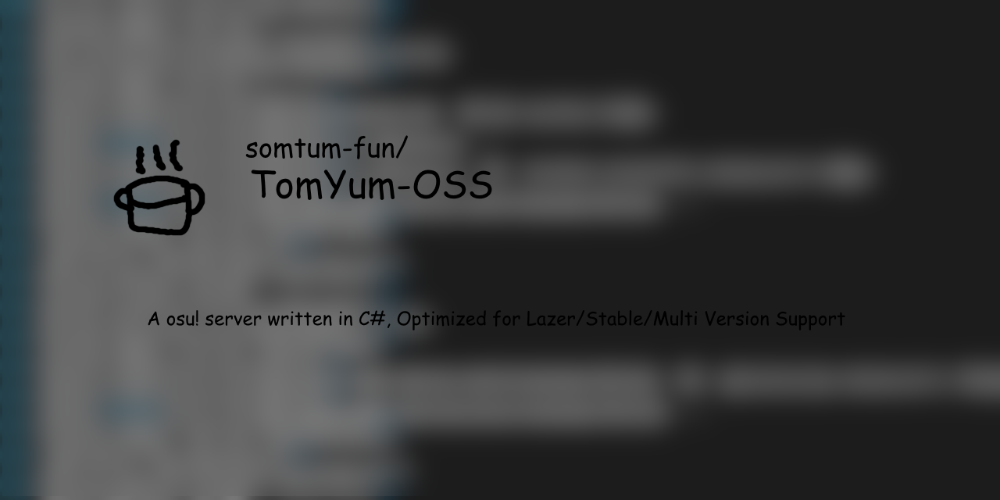

# TomYum



An extensible, horizontally scalable [osu!](https://osu.ppy.sh) bancho server written in
C# / .NET 10, supporting **both** the osu!stable and osu!lazer clients.

## Technologies

- ASP.NET Core (.NET 10)
- MySQL 8.4 (EF Core + Pomelo 9)
- Redis
- Docker / k8s / k3s
- Caddy (edge + storage fronting)

## Progress

> Status: **used in production** (osu!stable, osu!lazer and the website on one account system).
> Version `0.5.0`, production-ready. Docs: [docs.somtum.fun](https://docs.somtum.fun). What's left is in
> [docs/ROADMAP.md](docs/ROADMAP.md).

## Supported rulesets

| Ruleset | ID | ShortName (lazer) | osu!stable | osu!lazer | pp algorithm |
|---|:-:|:-:|:-:|:-:|---|
| osu! | 0 | `osu` | ✅ | ✅ | ppy's official calculator |
| osu!taiko | 1 | `taiko` | ✅ | ✅ | ppy's official calculator |
| osu!catch | 2 | `fruits` | ✅ | ✅ | ppy's official calculator |
| osu!mania | 3 | `mania` | ✅ | ✅ | ppy's official calculator |
| osu! (Relax) | 4 | `osu` + RX | ✅ | ✅ | [akatsuki-pp-rs](https://github.com/osuAkatsuki/akatsuki-pp-rs) (Akatsuki's `osu_2019` relax formula) |
| osu!taiko (Relax) | 5 | `taiko` + RX | ✅ | ✅ | akatsuki-pp-rs |
| osu!catch (Relax) | 6 | `fruits` + RX | ✅ | ✅ | akatsuki-pp-rs |
| osu! (Autopilot) | 8 | `osu` + AP | ✅ | ✅ | akatsuki-pp-rs |

IDs follow bancho.py: Relax is the mode + 4 and Autopilot the mode + 8 (osu!mania has no Relax).
Relax and Autopilot have their own leaderboards, stats and rankings, ranked by pp, and lazer plays
with those mods count towards them too. Their pp comes from the `pp-sidecar` (`sidecars/pp-sidecar`).
Custom lazer rulesets (Sentakki, tau, Rush!, ...) aren't supported yet.

## Core features

* Login and in-game registration, one account for osu!stable, osu!lazer and the website
* Score submission and leaderboards (global, selected mods, friends, country), with replays
* Chat: channels, PMs, away messages, friends-only PMs, friends shared with lazer and the website
* BanchoBot with `!`-commands, and an IRC server (port 6667) for IRC clients and bots
* Multiplayer: lobby, rooms, the full match lifecycle, `!mp` commands, the tournament client
* Spectating (stable, and lazer through [osu-server-spectator](https://github.com/ppy/osu-server-spectator))
* osu!lazer: multiplayer, playlists, the daily challenge and Ranked Play (matchmaking)
* Server website: [osu-web](https://github.com/ppy/osu-web) with TomYum's changes ([osu-web-tomyum](https://github.com/somtum-fun/osu-web-tomyum))
* Support for non-standard modes: Relax and Autopilot, ScoreV2 in multiplayer
* Custom beatmaps (uploaded sets, graveyard, guest difficulties) next to the official ones
* osu!direct, favourites, screenshots, in-game comments, star ratings with mods
* Beatmap hype and nominations on the website, with BN imports
* Achievements (medals)
* Rank snapshots (rank history for every mode)
* Seasonal backgrounds, uploaded from the admin panel
* Moderation: restrictions, silences, a chat log, score removal and staff panels on the website
* Anti-cheat hooks: hardware/client hash checks and alt detection; replay checks can be added as a plugin
* Plugins: compiled `.dll` or loose `.cs`, with events, commands and HTTP routes

## Additional features

* Automated tests (unit tests, plus integration tests against a real MySQL)
* pp reworks from the admin panel, and an updater that keeps the pp libraries current
* Metrics for Prometheus (the `tomyum-metrics` plugin) and a watchdog that sends alerts by Discord DM
* Redis for caching and shared state
* Docker Compose, k8s and k3s deployment, with Caddy in front
* Database migrations (EF Core)
* Nightly database backups
* A changelog made from the repositories' history on every deploy
* Email (sign-up verification)

**Not done yet** (see the [roadmap](docs/ROADMAP.md)): custom medals, multi-instance (Redis-backed)
online state, and object storage.

## Building

### Prerequisites

- .NET SDK 10.0 (pinned in `global.json`)
- MySQL / MariaDB Server
- Redis Server

### Building

1. Clone the repository to your local machine.
```bash
git clone https://github.com/somtum-fun/TomYum-OSS.git
```
2. Navigate to the project directory.
```bash
cd TomYum
```
3. Restore the project dependencies.
```bash
dotnet restore TomYum.sln
```
4. Build the solution (warnings are errors).
```bash
dotnet build TomYum.sln
```
5. Run the tests.
```bash
dotnet test TomYum.sln
```

## Usage

### Running

1. Start local dependencies (MySQL + Redis).
```bash
docker compose -f deploy/docker/docker-compose.yml up -d mysql redis
```
2. Run the server host (health probe at `/health`).
```bash
scripts/dev-server.sh
```
This wraps `dotnet run` with the right environment (`ASPNETCORE_ENVIRONMENT=Development` so the
config loads, and the DB password injected to match the compose defaults). On a successful start
the log prints `Database schema ensured (...)`, confirming it is using MySQL rather than the
in-memory fallback. Pass `DB=off scripts/dev-server.sh` to run without a database.

TomYum routes by subdomain (`c`, `c4`, `cho` for bancho, `osu` for `/web/*.php`). Front it
with Caddy and point the subdomain records at your host — see `deploy/caddy/Caddyfile`.

### Website (osu-web)

The website is [osu-web](https://github.com/ppy/osu-web), run alongside TomYum on the same MySQL and
Redis, with Caddy splitting `osu.<domain>` between the two. See [docs/osu-web.md](docs/osu-web.md)
for setup and the plan for sharing one database. Moving an existing TomYum server with players onto
the website: [tools/MigrateToOsuWeb](tools/MigrateToOsuWeb/README.md); moving a bancho.py server
(bancho.py, bancho.py-ex, kawata.py) here: [tools/ImportBanchoPy](tools/ImportBanchoPy/README.md).
Running the whole stack on one machine to try it: [docs/local-testing.md](docs/local-testing.md).

### Deployment

Docker, k8s, k3s, and Caddy scaffolding lives under `deploy/`.

## Documentation

The docs are at **[docs.somtum.fun](https://docs.somtum.fun)**: requirements, a step-by-step production setup, your domain
and Cloudflare, configuration, updating and backups.

[Introduction](https://docs.somtum.fun/guide/introduction) · [production setup](https://docs.somtum.fun/guide/production) ·
[domain setup](https://docs.somtum.fun/guide/domain-setup) · [osu-web](https://docs.somtum.fun/guide/osu-web) · [lazer](https://docs.somtum.fun/clients/lazer) ·
[old clients](https://docs.somtum.fun/clients/old-clients) · [custom beatmaps](https://docs.somtum.fun/features/custom-beatmaps) ·
[plugins](https://docs.somtum.fun/operations/plugins) · [configuration](https://docs.somtum.fun/reference/configuration) ·
[local testing](https://docs.somtum.fun/guide/local-testing) · [roadmap](https://docs.somtum.fun/reference/roadmap)

Configuration samples are under `config/`, and deployment scaffolding (Docker, k8s, k3s, Caddy)
under `deploy/`.

## Contributing

- **Fork** the Project
- Create your **Feature Branch** `git checkout -b feature/AmazingFeature`
- Commit your **Changes** `git commit -m 'Add some AmazingFeature'`
- Push **to the Branch** `git push origin feature/AmazingFeature`
- Open a **Pull Request**

Our team believes in using AI as an assistant, always under human review. Low-effort AI-generated ("slop") pull requests or comments may be closed without notice.

## Security

Found a security problem? Please don't open an issue: email [mind@somtum.fun](mailto:mind@somtum.fun).
See [SECURITY.md](SECURITY.md).

## License

TomYum is licensed under the MIT License. Please see the [LICENSE](LICENSE) file for more
information. Copyright (c) 2026 blueskychan-dev, somtum.fun & sundeiii.

## Acknowledgments

- Heavily inspired by [bancho.py](https://github.com/osuAkatsuki/bancho.py)
- [BanchoNET](https://github.com/NovemoG/BanchoNET) — osu!stable server in C#
- [Sunrise](https://github.com/SunriseCommunity/Sunrise) — osu!stable server in C#
- [osu!](https://github.com/ppy/osu) and [osu-server-spectator](https://github.com/ppy/osu-server-spectator) — official lazer client & spectator server
- [g0v0-server](https://github.com/GooGuTeam/g0v0-server) — osu!lazer server (Python), referenced for lazer API/flow understanding
- [rosu-pp](https://github.com/MaxOhn/rosu-pp) — fast PP/difficulty calculation
